# CareerPilot AI — Agentic AI Career Intelligence Platform

[](https://github.com/careerpilot-ai/careerpilot/actions)
[](https://www.python.org/)
[](https://fastapi.tiangolo.com/)
[](https://nextjs.org/)
[](https://github.com/pgvector/pgvector)
[](https://opensource.org/licenses/MIT)

**CareerPilot AI** is an enterprise-grade, agentic career intelligence platform designed to empower students and software engineers in landing their dream roles. By combining high-dimensional dense vector embeddings, hybrid semantic matching, real-time job ingestion, and an autonomous LangGraph career assistant with dynamic tool calling, CareerPilot AI transforms career navigation into a deterministic, AI-accelerated science.

---

## 🏗️ System Architecture

```mermaid
flowchart TD
    subgraph Client["Frontend: Next.js 14 / TypeScript / Tailwind CSS"]
        UI_Dash["Dashboard & Analytics"]
        UI_Resume["Resume Studio & Parser Inspector"]
        UI_Jobs["Semantic Job Explorer & Hybrid Board"]
        UI_Roadmap["Skill Gap & Roadmap Engine"]
        UI_Chat["Agentic Career Assistant UI"]
        UI_Tracker["Job Application Kanban Tracker"]
        UI_Cover["AI Cover Letter Studio"]
    end

    subgraph API_Gateway["API & Security Layer (FastAPI)"]
        Auth["JWT Auth & Security (bcrypt, OAuth2)"]
        Router["REST & Streaming Endpoints (/api/v1)"]
        Validator["Pydantic v2 Input/Output Validation"]
    end

    subgraph CoreEngine["Core Intelligence Engine"]
        Parser["Resume Parsing & OCR Engine (PDF/DOCX -> Structured JSON)"]
        Ingestion["Live Multi-Source Job Ingestion (RemoteOK, Arbeitnow, Curated)"]
        Embedder["Dense Semantic Embeddings (SentenceTransformers / Gemini)"]
        Ranker["Hybrid Recommendation Engine (Semantic 50% + Skill 35% + Exp 15%)"]
        GapAnalyzer["Skill Graph & Personalized Roadmap Generator"]
        Agent["LangGraph Autonomous Career Agent (Tools + State Memory)"]
    end

    subgraph DataStore["Data & Persistence Layer"]
        Postgres[("PostgreSQL 16 + pgvector")]
        VectorStore[("384-d Vector Index (HNSW / Cosine)")]
        FileStorage["Secure Document Storage"]
    end

    Client --> API_Gateway
    API_Gateway --> CoreEngine
    CoreEngine --> DataStore
```



---

## 🚀 Key Features

### 1. Resume Upload, OCR & AI-Based Parsing
- Ingests **PDF, DOCX, and TXT** documents with robust fallback text extraction.
- Parses unstructured text into a strongly typed Pydantic v2 schema: candidate contact info, summary, total years experience, technical skills, soft skills, tools & frameworks, employment history, education, and projects.
- Powered by a dual-engine architecture: Gemini 1.5 Flash multimodal parser combined with an expansive token-boundary NLP rule engine.

### 2. Live Job Discovery & Multi-Source Ingestion
- Real-time connector to public tech job feeds: **RemoteOK API**, **Arbeitnow API**, and an integrated catalog of 50+ curated high-tech postings.
- Auto-embedding pipeline: cleans HTML, extracts tech tags, generates 384-dimensional dense vectors, and eliminates duplicates on ingestion.

### 3. Semantic Vector Search with pgvector
- Uses PostgreSQL 16 with native `pgvector` extension for sub-millisecond approximate nearest neighbor (ANN) vector queries.
- Matches candidate experience vectors against job requirement embeddings using Cosine distance:
  $$\text{Cosine Similarity}(\vec{u}, \vec{v}) = \frac{\vec{u} \cdot \vec{v}}{\|\vec{u}\|_2 \|\vec{v}\|_2}$$

### 4. Hybrid Job Recommendation & Ranking Engine
Calculates a composite suitability score combining three distinct signals:
$$\text{Composite Score} = (0.50 \times S_{\text{semantic}} + 0.35 \times S_{\text{skill}} + 0.15 \times S_{\text{experience}}) \times 100$$
- **Semantic Vector Similarity (50%)**: Captures deep conceptual alignment between resume background and job requirements.
- **Skill Graph Overlap (35%)**: Exact and fuzzy token-boundary intersection between candidate skills and required technologies.
- **Experience Trajectory (15%)**: Alignment between candidate years of experience and target seniority (Entry, Mid, Senior, Lead).
- Outputs dynamic natural language justifications (e.g., *"Strong semantic profile alignment (88%) • Matches 4 of 5 required skills (Python, FastAPI, Docker, PostgreSQL) • Missing: Kubernetes"*).

### 5. Autonomous LangGraph Career Assistant
- Agentic copilot featuring cyclical state graph execution and tool calling:
  - `search_jobs(query, location, remote_only)`: Queries semantic database.
  - `analyze_skill_gap(job_id_or_title)`: Compares candidate skills against job requirements.
  - `get_user_resume_summary()`: Inspects candidate background for contextual guidance.
  - `draft_cover_letter(job_id, tone)`: Generates custom cover letters.
- **Tool-Calling Transparency**: UI displays autonomous tool actions and summaries in real-time.
- Session memory: full transcript history stored in PostgreSQL.

### 6. Skill Gap Diagnostics & Personalized Learning Roadmaps
- Identifies exact missing competencies between user resume and target roles.
- Generates milestone-driven learning roadmaps with:
  - Step order, importance category (Critical vs Recommended), and estimated duration.
  - Core architecture concepts to study.
  - Practical capstone portfolio project to build.
  - Curated learning resources (official documentation, top tutorials, courses).

### 7. AI Cover Letter Studio
- Context-aware generation tailoring user projects and metrics to target job postings.
- Configurable tones: **Professional**, **Technical**, **Enthusiastic**, and **Executive**.
- In-browser editable canvas with 1-click clipboard copy and `.txt` file export.

### 8. Job Application Pipeline Tracker (Kanban)
- Drag-and-drop / select status across stages: **Saved**, **Applied**, **Interviewing**, **Offer**, and **Rejected**.
- Timestamp logging and interview notes scratchpad.

### 9. Automated Testing & AI Evaluation Benchmark
- Pytest suite covering authentication, parsing, vector math, and agent tools.
- Dedicated benchmark suite (`backend/eval/evaluate_ai.py`) computing **Precision, Recall, F1 Score, and Mean Reciprocal Rank (MRR)**.

---

## 📊 Benchmark & Evaluation Results

Evaluated on ground-truth engineering resumes and role profiles:

| Evaluation Metric | Benchmark Target | CareerPilot AI Result |
| :--- | :--- | :--- |
| **Resume Skill Extraction F1 Score** | $> 90.0\%$ | **97.0%** (Precision: 94.4%, Recall: 100.0%) |
| **Ranking Mean Reciprocal Rank (MRR)** | $> 0.850$ | **1.000** |
| **Top-1 Recommendation Accuracy** | $> 80.0\%$ | **100.0%** |
| **Backend Unit Test Pass Rate** | $100\%$ | **13 / 13 Passed (100%)** |

---

## 🛠️ Technology Stack

| Layer | Technologies |
| :--- | :--- |
| **Frontend** | Next.js 14 (App Router), React 18, TypeScript, Tailwind CSS, Lucide Icons, Axios |
| **Backend** | Python 3.11 / 3.13, FastAPI, Pydantic v2, SQLAlchemy 2.0, Uvicorn |
| **Database** | PostgreSQL 16, pgvector extension (with graceful SQLite fallback for testing) |
| **AI & NLP** | Google Gemini 1.5 Flash API, SentenceTransformers (`all-MiniLM-L6-v2`), NumPy |
| **Agent Framework** | LangChain / LangGraph (Autonomous State Graph + Tool Dispatching) |
| **DevOps & CI/CD** | Docker Compose, Multi-stage Dockerfiles, GitHub Actions CI |

---

## ⚡ Quick Start & Local Setup

### Prerequisites
- Python 3.11+
- Node.js 18+ & npm
- Docker & Docker Compose (optional, for containerized run)

---

### Option A: Local Development (Fastest)

#### 1. Backend Setup
```bash
# Navigate to backend directory
cd backend

# Create virtual environment
python -m venv venv

# Activate virtual environment
# Windows:
.\venv\Scripts\activate
# Linux/macOS:
source venv/bin/activate

# Install dependencies
pip install -r requirements.txt

# Start FastAPI development server (auto-creates SQLite DB & seeds curated jobs)
python run.py
```
Backend API will be running at: `http://localhost:8000`  
Interactive OpenAPI Swagger docs: `http://localhost:8000/docs`

#### 2. Run Backend Tests & AI Benchmark
```bash
# Run 13 automated tests
python -m pytest -v

# Run AI Evaluation suite
python eval/evaluate_ai.py
```

#### 3. Frontend Setup
```bash
# In a new terminal, navigate to frontend
cd frontend

# Install npm dependencies
npm install

# Start Next.js development server
npm run dev
```
Frontend web application will be live at: `http://localhost:3000`

---

### Option B: Docker Compose Deployment (Production-Ready)

Run the entire platform (PostgreSQL 16 + pgvector, FastAPI backend, Next.js frontend) with a single command:

```bash
# Build and launch all containers
docker-compose up --build
```

- **Frontend**: `http://localhost:3000`
- **Backend API**: `http://localhost:8000`
- **Swagger Docs**: `http://localhost:8000/docs`
- **Postgres Database**: `localhost:5432`

---

## 📖 API Endpoints Reference

### Authentication
- `POST /api/v1/auth/register` — Register a new user account.
- `POST /api/v1/auth/login` — Authenticate and receive JWT bearer token.
- `GET /api/v1/auth/me` — Retrieve current authenticated user profile.

### Resume Studio
- `POST /api/v1/resumes/upload` — Upload PDF/DOCX resume for OCR, AI parsing, and vector indexing.
- `GET /api/v1/resumes/active` — Get currently active parsed resume.
- `GET /api/v1/resumes/` — List all user resumes.
- `DELETE /api/v1/resumes/{id}` — Delete a resume.

### Job Discovery & Matching
- `GET /api/v1/jobs/` — Search jobs by keyword, location, and remote type.
- `GET /api/v1/jobs/{id}` — Retrieve single job details.
- `POST /api/v1/jobs/sync` — Ingest jobs from live APIs (RemoteOK, Arbeitnow) and curated seeds.
- `GET /api/v1/recommendations/` — Retrieve personalized jobs ranked by Hybrid Engine.

### Skill Gap & Learning Roadmaps
- `POST /api/v1/skills/analyze` — Run skill gap diagnostics for target job or engineering role.
- `GET /api/v1/skills/history` — List past generated skill reports.

### AI Cover Letter Studio
- `POST /api/v1/cover-letters/generate` — Generate tailored cover letter with chosen tone.
- `GET /api/v1/cover-letters/` — Retrieve previously generated letters.

### Application Pipeline Tracker
- `GET /api/v1/applications/` — List tracked applications.
- `POST /api/v1/applications/` — Track a new application.
- `PATCH /api/v1/applications/{id}` — Update status or interview notes.
- `DELETE /api/v1/applications/{id}` — Remove from tracker.

### AI Career Copilot
- `POST /api/v1/assistant/chat` — Interact with autonomous LangGraph career agent.
- `GET /api/v1/assistant/sessions` — List conversation sessions.
- `GET /api/v1/assistant/sessions/{id}` — Get message transcript for a session.

---

## 🔐 Environment Variables

Create `.env` based on `.env.example`:

```env
ENVIRONMENT=development
PROJECT_NAME="CareerPilot AI"
API_V1_STR=/api/v1
SECRET_KEY=careerpilot_super_secret_jwt_key_2026_xyz
ALGORITHM=HS256
ACCESS_TOKEN_EXPIRE_MINUTES=1440

# Database (PostgreSQL + pgvector in Docker, SQLite locally)
DATABASE_URL=sqlite:///./careerpilot.db
VECTOR_DIMENSION=384

# AI APIs (Optional: Get free API key from https://aistudio.google.com/)
GEMINI_API_KEY=""

FRONTEND_URL=http://localhost:3000
```

---

## 📄 License
This project is licensed under the MIT License — see the [LICENSE](LICENSE) file for details.
